<p align="center">
  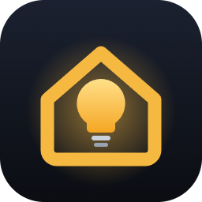
</p>

<h1 align="center">Lychnos</h1>

<p align="center">
  <b>L</b>ocal <b>Y</b>our-home <b>C</b>ontrol <b>H</b>ub · <b>N</b>o <b>O</b>utside <b>S</b>ervers<br>
  <i>Local-first smart lighting, controlled from a dashboard and by Claude.</i>
</p>

<p align="center">
  <a href="https://github.com/npsaltakis/lychnos-mcp/actions/workflows/ci.yml"></a>
  
  
  
  
</p>

A **local-first** control center for Wi-Fi smart lights on Windows and Linux: a FastAPI backend, a React dashboard
and an **MCP server** so you can control your lights from **Claude Desktop** and **Claude Code**
("turn the Govee light purple", "turn off all lights", "create a movie-night scene").

Devices are controlled **directly on your LAN** using each manufacturer's documented local protocol. No
browser automation, no Google Home scraping, no cloud round-trips for everyday use. Your existing apps
(Google Home, Govee Home, eWeLink) keep working side by side.

> **Honest by design:** a command is only reported as successful when the device itself confirms the new
> state. Otherwise it is shown as *unconfirmed*, *mismatch* or *failed*.

### About the name

**Lychnos** (Greek *λύχνος*, pronounced *LEEKH-nos*) is the oil lamp of ancient Greece: the small,
simple, self-contained light every home had. That is the idea of this project: your lights, controlled
from your own home, without depending on anyone else's servers.

The name is also an acronym of what the project is:

| Letter | Stands for | Meaning |
|---|---|---|
| **L** | **L**ocal | Everything runs on your own computer and network |
| **Y** | **Y**our-home | Your devices, your data, your rules |
| **C** | **C**ontrol | One place for every light: dashboard, scenes and Claude |
| **H** | **H**ub | One backend that speaks each brand's own protocol |
| **N** | **N**o | |
| **O** | **O**utside | |
| **S** | **S**ervers | Commands go straight to the lights over your LAN, never through a cloud |

> Technical identifiers keep their original names for compatibility: the MCP server is still called
> `smart-home`, settings use the `SHC_` prefix and the data folder is `.smarthome-control`.

---

## Screenshots

| Dashboard | Mobile |
|---|---|
| 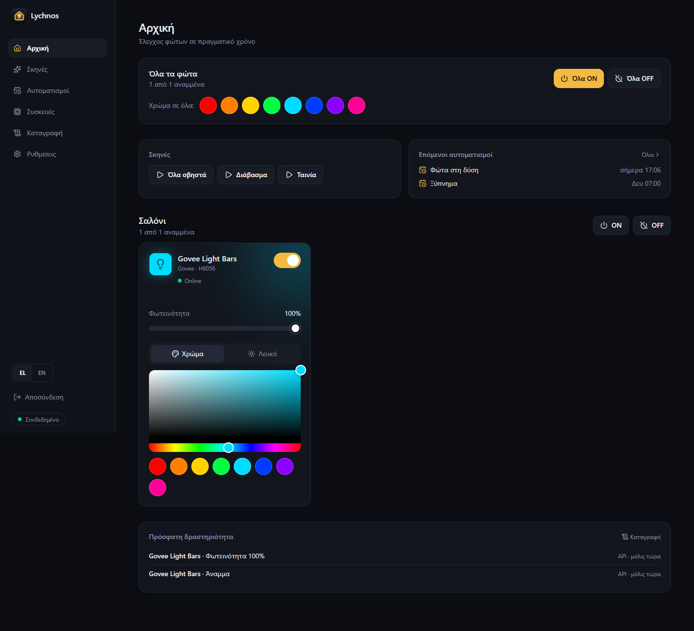 | 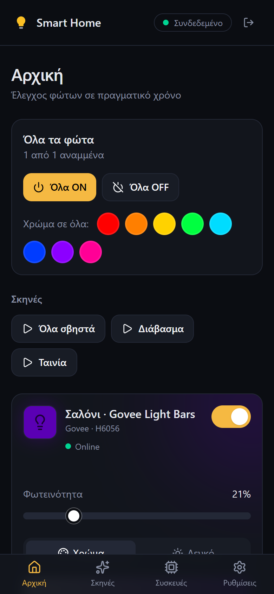 |

| Log | Log on a phone |
|---|---|
| 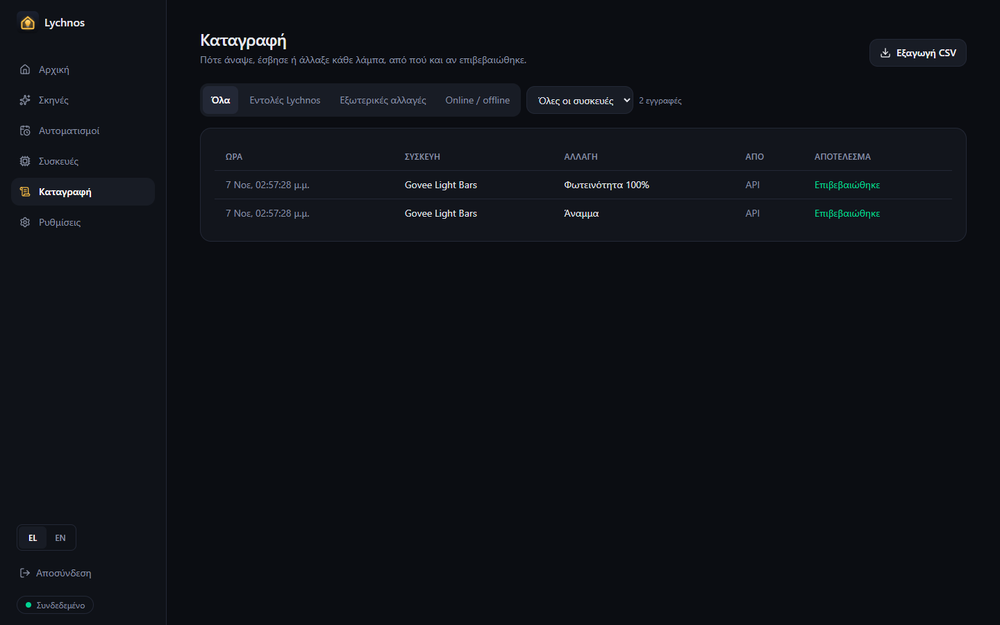 | 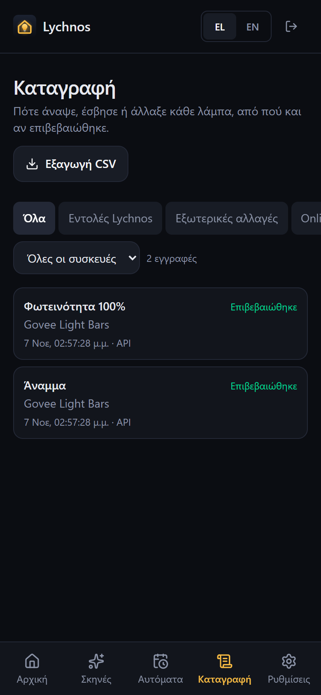 |

| Automations | Scenes |
|---|---|
| 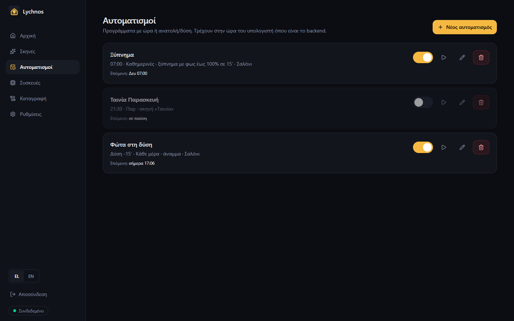 | 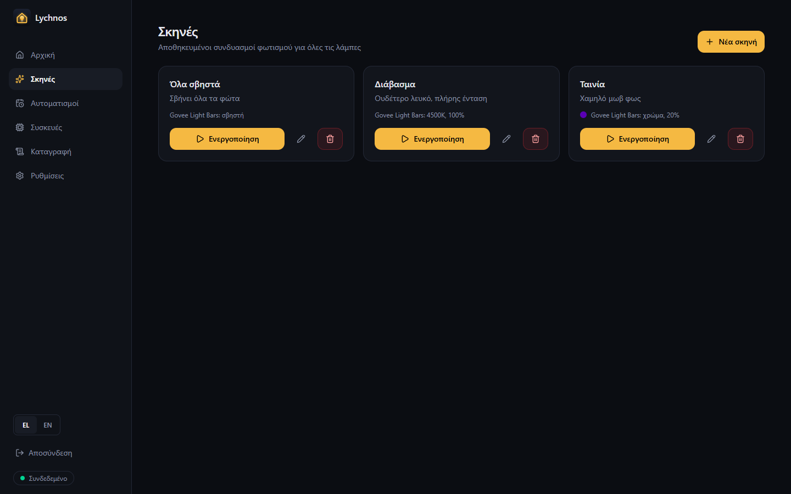 |

| Devices and rooms | Settings |
|---|---|
| 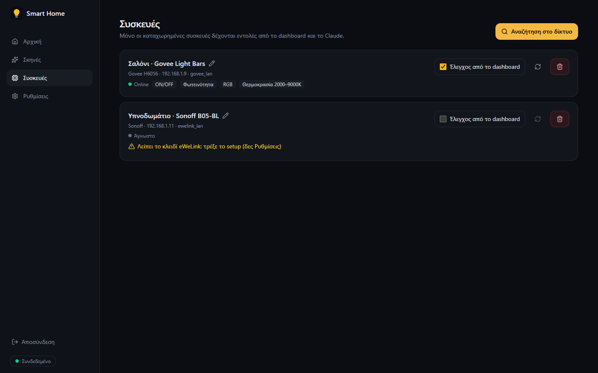 | 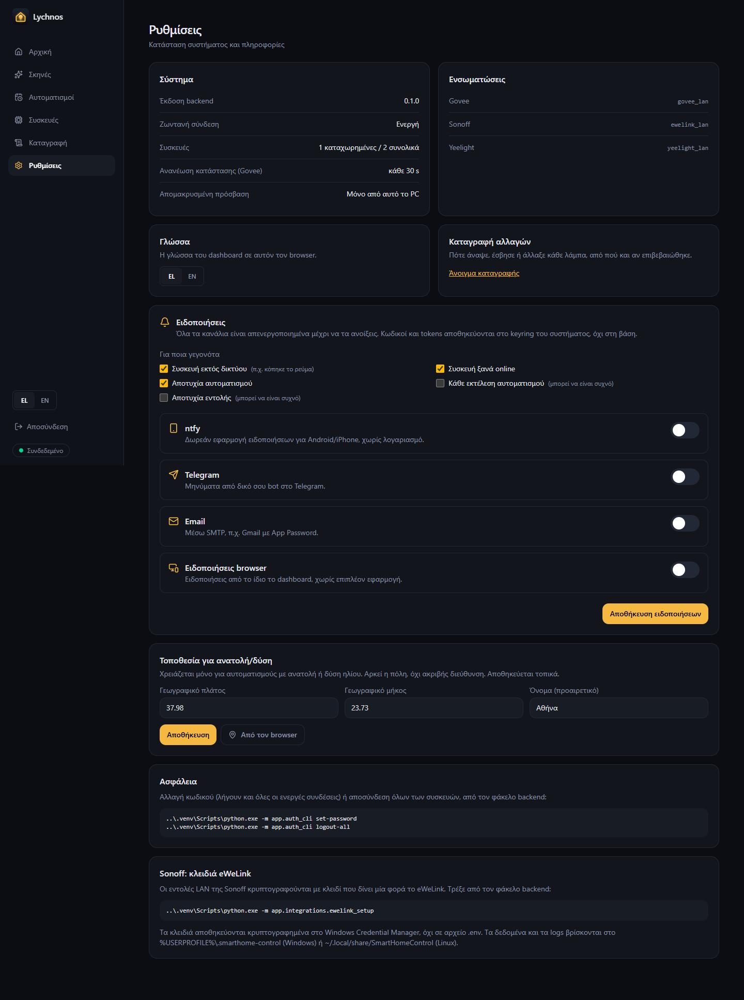 |

| Login | |
|---|---|
| 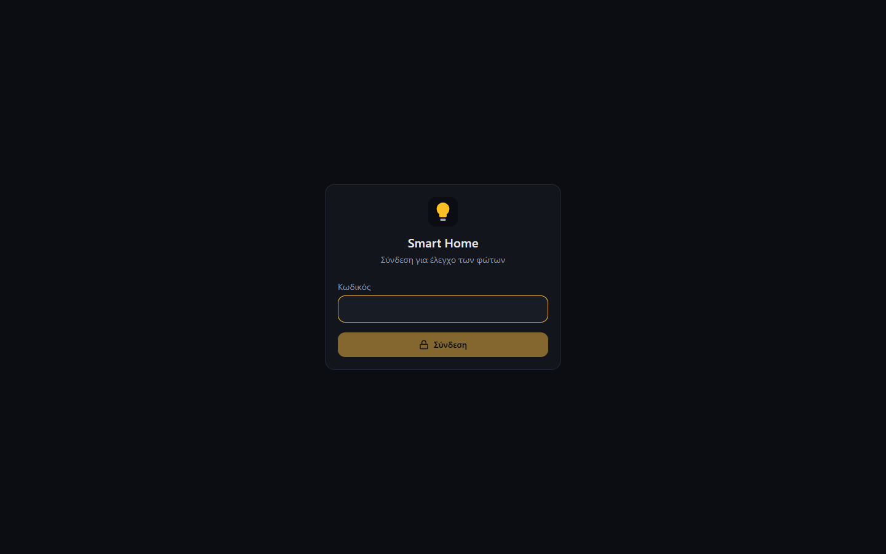 | |

## Features

- **Dashboard** (React + Tailwind, dark, mobile-friendly): per-light cards with on/off, brightness,
  colour picker, colour temperature and presets; *All lights* controls; scenes; device discovery and
  registration; live updates over WebSocket; toast notifications.
- **Rooms**: group lights into rooms (Living room, Bedroom…). The home page is organised by room, with
  on/off per room, and rooms can be used as targets everywhere (scenes aside), including from Claude.
- **Automations**: run at a time of day or at sunrise/sunset (± minutes, using your location), on chosen
  weekdays. Actions: activate a scene, switch/colour/dim a light, a room or all lights, or a gradual
  **wake-up light** that fades in over N minutes and stops if you switch the light off. Runs missed while the
  backend was off are skipped, never replayed. A **sleep light** does the opposite: it dims the lights that are
  on from their current brightness and switches them off over N minutes.
- **Govee RGBIC segments**: gradients along the light (presets or two colours, optionally the same on each bar),
  sent locally. Verified on the H6056 light bars (2 bars × 6 segments).
- **Govee music mode** (optional, cloud): the light follows the sound with its own microphone, in the styles the
  light offers (H6056: Vivid, Strike, Rhythm, Vibrate, Beat, Torch, Rainbow circle, Shiny) and with adjustable
  sensitivity. One button starts and stops it. The LAN API and plain Bluetooth packets do not switch music mode on
  (both tested on the H6056), so it uses Govee's official cloud API with a free API key and needs internet;
  everything else stays local. Verified on hardware.
- **Weather** on the home page (Open-Meteo, free, no key): now, today's high/low, feels-like, rain chance, wind,
  sunset and the next two days, for the location in Settings. Sunset automations can run 15–60 minutes earlier
  when the forecast is cloudy.
- **Location by address**: type an address or a town in Settings → Location (OpenStreetMap search, free, no key);
  a single match is saved at once, several are listed to pick from. Coordinates can still be entered by hand or
  taken from the browser. Used for the weather and for sunrise/sunset times.
- **Scenes with extras**: besides on/off, colour, white and brightness, a light in a scene can get a gradient
  (RGBIC lights), an effect or music mode, e.g. a *Party* scene with the bars in music mode.
- **Light effects**: rainbow, breathe and candle, run by Lychnos itself so they work on any colour light. An
  effect stops when you stop it or give that light any other command.
- **Bathroom scale** (Bluetooth, local, no cloud): the weight is read from the scale's own Bluetooth broadcasts
  as you stand on it, so nothing is paired and the vendor app keeps working. The home page shows the latest
  weight, the change over 7 and 30 days and a chart (30 / 90 / 365 days); wrong weighings (a guest) can be
  deleted. Scales are found with the same *Search the network* (stand on the scale while it searches), appear
  under **Devices → Scales** and can be renamed and put in a room. Optional notification on every weighing with
  the change since the last one, and Claude can answer "how much did I weigh this month?". Supported: **Eufy
  Smart Scale C20** (T9130, verified on hardware) and **Xiaomi Mi Smart Scale / Mi Body Composition Scale 2**
  (from their published format, not yet hardware-verified). The scale has to be within Bluetooth range of the
  computer.
- **Presence**: knows whether anyone is home from the phones on the home Wi-Fi (MAC address from the computer's
  neighbour table plus a ping; no app on the phone). A *Devices on the network* list helps pick the phone. Shows
  who is home and since when. After N minutes without an answer (phones sleep their Wi-Fi) someone counts as
  away; when everyone has left it can switch everything off, and when someone arrives it can switch the lights on
  or run a scene, optionally only after dark. Verified on hardware (lights off 5 minutes after the phone left).
- **Vacation mode**: every evening, from sunset (or a set time) to a set end time, lights go on and off at
  random so the home looks lived in; at the end it switches off whatever it lit.
- **Usage statistics**: hours on per light per day (7 or 30 days), counted from every change, including
  Google Home and wall switches.
- **Daily backups** of the database (devices, rooms, scenes, automations, log), keeping the last 14, plus a
  *Back up now* button. Secrets are not in the database.
- **Telegram commands** (optional): write to your bot “on”, “off living room”, “40%”, “scene movie”, “status” or
  “menu” for buttons. It only obeys your own chat id and uses long polling, so nothing is exposed to the internet.
- **Log**: every switch-on, switch-off, brightness and colour change with its time, who made it (dashboard,
  Claude, a scene, an automation, or an *external* change from Google Home, the vendor app or a wall switch) and
  whether the device confirmed it, plus when a light went offline and came back. Filter by device or type and
  export to CSV.
- **Greek / English**: the dashboard is fully bilingual; switch with EL/EN in the sidebar, on the sign-in page or
  in Settings (remembered per browser).
- **Notifications** (all off by default, each with its own switch and a *Test* button in Settings):
  [ntfy](https://ntfy.sh) (free phone app, no account), Telegram (your own bot), email (SMTP, e.g. Gmail with an
  App Password) and browser push notifications from the dashboard itself. Choose which events notify you: a light
  goes offline / comes back, an automation fails or runs, a command fails, a new weighing. Tokens and passwords are kept in the
  OS keyring, never in the database or `.env`.

  | Channel | Setup |
  |---|---|
  | ntfy | Install the ntfy app, subscribe to the (random) topic shown in Settings. Anyone who knows the topic name can read it, so keep it random. |
  | Telegram | Create a bot with @BotFather, send `/start` to it, paste the token and press *Find chat*. |
  | Email | SMTP server, port, user, App Password, sender and recipient. |
  | Browser | *Enable in this browser*. Needs a secure context: `http://127.0.0.1:3000` on this PC, or HTTPS (e.g. Tailscale) on a phone. |

  Viber and WhatsApp are not supported: Viber bots now require a paid commercial agreement, and WhatsApp needs a
  Meta Business account, a separate phone number and paid template messages.
- **Capability detection**: each card only shows the controls that device verifiably supports.
- **Confirmed vs pending state**: the UI shows "pending…" while a command is in flight and the result
  (`confirmed` / `unconfirmed` / `mismatch` / `failed`) with the round-trip time.
- **MCP server** (official Python SDK, stdio) with tools: `list_devices`, `list_rooms`, `get_device_state`,
  `turn_on`, `turn_off`, `set_brightness`, `set_color`, `set_color_temperature`, `list_scenes`,
  `activate_scene`, `create_scene`, `list_automations`, `create_automation`, `set_automation_enabled`,
  `delete_automation`, `start_effect`, `stop_effects`, `set_gradient`, `music_mode`, `get_weight`. Automations include `wake_up_fade` and `sleep_fade`. Device, room and colour names (English and Greek) are resolved for you.
- **Security**: password login, HttpOnly/SameSite=Strict sessions, brute-force lockout, CSRF and DNS
  rebinding protection, API bound to `127.0.0.1`, secrets kept outside the repository.
- **Extensible**: a provider/adapter interface; adding a brand does not touch the core, the dashboard or MCP.

## Supported devices

Support is **per protocol**, not per individual device. Any device that speaks a supported protocol works.

| Integration | Protocol | Devices | Local? | Needs | Status |
|---|---|---|---|---|---|
| `govee_lan` | [Govee LAN API](https://app-h5.govee.com/user-manual/wlan-guide) (UDP) | ~250 Govee light models (strips, bars, bulbs, lamps). Check the official list. | ✅ | "LAN Control" enabled per device in the Govee Home app | ✅ Verified on hardware (H6056) |
| `ewelink_lan` | eWeLink LAN (mDNS + encrypted HTTP) | Sonoff / eWeLink devices on stock firmware. Currently: RGB+CCT bulbs (UIID 104 and 136, e.g. **B05-BL**) | ✅ (after a one-time key fetch) | Free [eWeLink developer](https://dev.ewelink.cc) app to fetch device keys once | ✅ Verified on hardware (B05-BL, UIID 136) |
| `wiz_lan` | WiZ local UDP (JSON on port 38899, broadcast discovery) | **WiZ / Philips WiZ** bulbs, strips and plugs. RGB, tunable-white, dimmable and socket models are told apart by module name. | ✅ No keys, no cloud | "Allow local communication" on in the WiZ app (default) | ✅ Implemented and tested against a simulated light; not yet hardware-verified |
| `shelly_lan` | Shelly local HTTP (Gen1 `/relay/0`, Gen2+ RPC `Switch.*`) | **Shelly** relays and plugs (Shelly 1, Plug S, Plus 1, Plus Plug, Pro, Gen3 …): on/off | ✅ No keys, no cloud | No password on the device (restricted login off) | ✅ Implemented and tested against simulated Gen1 and Gen2 devices; not yet hardware-verified |
| Scales (built in) | Bluetooth LE advertisements (passive listening) | **Eufy Smart Scale C20** (T9130); **Xiaomi Mi Smart Scale** and **Mi Body Composition Scale 2** | ✅ No keys, no cloud, no pairing | Bluetooth on the computer, scale within range | ✅ Eufy C20 verified on hardware; Xiaomi from the published format |
| `yeelight_lan` | [Yeelight LAN protocol](https://www.yeelight.com/download/Yeelight_Inter-Operation_Spec.pdf) (SSDP discovery on UDP 1982, TCP 55443, push notifications) | **Xiaomi / Yeelight** lights: colour and white bulbs, light strips, ceiling, bedside and desk lamps. Capabilities and colour-temperature range are detected from what each light reports. | ✅ No keys, no cloud | "LAN Control" enabled per light in the **Yeelight** app | ✅ Implemented and tested against a simulated bulb (spec-conformant); not yet hardware-verified |

### Xiaomi lights

- **Yeelight-family lights** (sold as Yeelight or Xiaomi/Mi, controllable from the Yeelight app) are supported
  through `yeelight_lan`: on/off, brightness, RGB and colour temperature, with live updates when the light is
  changed from another app (Google Home, Yeelight, Mi Home).
  Enable it with `SHC_ENABLED_PROVIDERS=["govee_lan","ewelink_lan","yeelight_lan"]`, turn on **LAN Control** in
  the Yeelight app, then **Devices → Search the network**.
- **Xiaomi Mi Home-only lights** (miIO/MIoT protocol) are **not** supported: they need a per-device token that
  Xiaomi does not provide through an official API. For newer Xiaomi lights, prefer models with **Matter**
  support (see below).

Planned or possible integrations (see [Adding a new brand](#adding-a-new-brand)):

| Brand / standard | Local protocol | Notes |
|---|---|---|
| **Matter** (any brand, incl. newer Xiaomi) | Matter over Wi-Fi/Thread | The closest thing to "works with everything locally". Needs a Matter controller (e.g. python-matter-server); Thread devices also need a border router. |
| **Xiaomi Mi Home** (miIO/MIoT lights) | miIO (encrypted UDP 54321) | Needs a per-device token with no official way to obtain it, so it is not planned. |
| Philips Hue | Hue Bridge local REST API | Requires the Hue Bridge. |
| TP-Link Kasa / Tapo, LIFX, WiZ, Shelly, Nanoleaf | Documented/established LAN protocols | Each needs its own provider. |

> **Why isn't "any device on the LAN" enough?** Being reachable on the network does not mean a device can
> be controlled. Every manufacturer uses its own local protocol, and many require a per-device key.
> **Matter** is the industry standard that solves this. A Matter provider is the path to brand-independent control.

## Setting up the extras

All of these are optional and off until you turn them on.

- **Location** (Settings → Location, at the top): type your address or town, press *Search* and pick the right
  result. The weather card on the home page and the sunrise/sunset times use it. Only the coordinates and the
  name you picked are stored, on this computer; the search text is sent to OpenStreetMap, the coordinates to
  Open-Meteo for the forecast.

- **Presence** (Settings → Presence): press *Devices on the network*, find your phone (Android: Settings → Wi-Fi →
  your network → MAC address; entries marked *likely a phone* use a private address) and press *Use*. On the
  phone, set the Wi-Fi MAC type to *device MAC* or *randomised per network*, not *per connection*, or the address
  keeps changing. Choose what happens when everyone leaves / someone arrives and after how many minutes someone
  counts as away (15 is a safe default).
- **Vacation mode** (Settings → Vacation mode): pick the start (sunset or a time), the end time and the lights.
  Set your location first (see above) if you use sunset.
- **Sleep light** (Automations → action *Sleep (gradual fade-out)*), e.g. every night at 23:30 over 20 minutes.
- **Telegram commands** (Settings → Notifications → Telegram): set the bot token and press *Find chat* first,
  then tick *Also accept commands from this chat*. Commands work in Greek or English: `on`, `off living room`,
  `40%`, `scene movie`, `status`, `menu`.
- **Govee music mode**: in the Govee Home app, Profile → Settings → *Apply for API Key* (it arrives by email),
  then from `backend/`:

  ```bash
  ../.venv/Scripts/python.exe -m app.integrations.govee_key   # Windows; on Linux ../.venv/bin/python
  ```

  It asks for the key without showing it, checks it, stores it in the OS keyring and lists the music styles each
  light offers. No restart is needed. `--remove` deletes it.
- **Bathroom scale**: *Devices → Search the network* and **stand on the scale** while it searches (scales only
  broadcast while someone is on them), then press *Add*. The first weighing after that appears on the home page.
  Turn on *A new weighing* in Settings → Notifications for a message after each weighing.
- **Backups**: automatic every day in `<data folder>/backups` (last 14 kept); *Back up now* in Settings. To
  restore, stop the backend and copy a backup over `smarthome.db`.

## Architecture

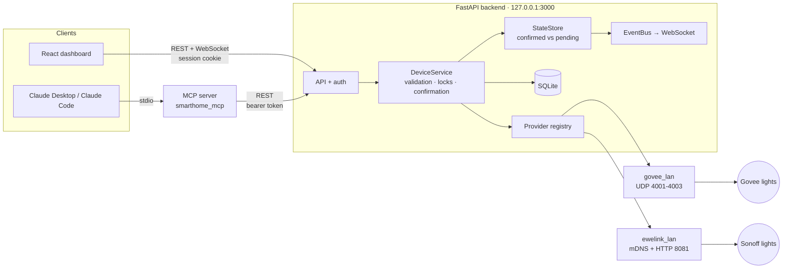

- **One backend owns all devices.** The dashboard and Claude share the same state, validation and per-device
  locking, so there are no duplicate network requests or conflicting commands.
- **Confirmation**: Govee commands are confirmed by reading `devStatus` back. Sonoff devices announce their
  new state over mDNS (push, no polling).
- **Polling** only for devices without push, and only while a dashboard or client is active.

## Platforms

Runs on **Windows 10/11**, **Linux desktops** (tested target: Linux Mint / Ubuntu) and macOS. The only
OS-specific parts are the paths shown below and where secrets are kept (see [Secrets](#secrets-os-keyring-not-env)).

| | Windows | Linux / macOS |
|---|---|---|
| venv Python | `.venv\Scripts\python.exe` | `.venv/bin/python` |
| Run script | `scripts\run-backend.ps1` | `scripts/run-backend.sh` |
| Data, logs, API token, password hash | `%USERPROFILE%\.smarthome-control\` | `~/.local/share/SmartHomeControl/` |
| Device keys | Windows Credential Manager | GNOME Keyring / KWallet (Linux), Keychain (macOS) |
| Claude Desktop config | `%APPDATA%\Claude\claude_desktop_config.json` | `~/Library/Application Support/Claude/…` (macOS) |

## Quick start

Requirements: **Python 3.11+** and **Node.js 20+**.

### Windows (PowerShell)

```powershell
git clone https://github.com/npsaltakis/lychnos-mcp.git
cd lychnos-mcp

python -m venv .venv
.venv\Scripts\python.exe -m pip install -e "backend[dev]" -e "mcp_server[dev]"
copy .env.example backend\.env                     # non-secret settings only

cd backend; ..\.venv\Scripts\python.exe -m app.auth_cli set-password; cd ..
cd frontend; npm install; npm run build; cd ..

powershell -ExecutionPolicy Bypass -File scripts\run-backend.ps1
```

### Linux (Mint / Ubuntu / Debian)

```bash
sudo apt install python3-venv python3-pip nodejs npm    # or Node.js 20+ from nodesource
git clone https://github.com/npsaltakis/lychnos-mcp.git
cd lychnos-mcp

python3 -m venv .venv
.venv/bin/python -m pip install -e "backend[dev]" -e "mcp_server[dev]"
cp .env.example backend/.env                       # non-secret settings only

(cd backend && ../.venv/bin/python -m app.auth_cli set-password)
(cd frontend && npm install && npm run build)

bash scripts/run-backend.sh
```

Open **http://127.0.0.1:3000**, log in, go to **Devices → Search the network** and enable the lights you want
to control. Only registered devices accept commands, from the dashboard and from Claude.

> Linux firewall: if `ufw` is enabled, allow the discovery replies from your LAN, e.g.
> `sudo ufw allow from 192.168.1.0/24 to any port 4002 proto udp` (Govee) and mDNS `5353/udp` (Sonoff).

### Device preparation

- **Govee**: Govee Home app → device → Settings → enable **LAN Control**.
  For music mode (optional): Govee Home app → Profile → Settings → **Apply for API Key**, then store it in the
  OS keyring with `python -m app.integrations.govee_key` (from `backend/`).
- **Xiaomi / Yeelight**: Yeelight app → light → enable **LAN Control**.
- **Sonoff (eWeLink)**: LAN commands are encrypted with a per-device key that only eWeLink provides. Fetch it once:
  1. Register at https://dev.ewelink.cc (free developer certification) and create an app with redirect URL
     `http://127.0.0.1:8765/ewelink/callback`.
  2. Run the setup (from `backend/`) and log in, in the page that opens, with the eWeLink account **that has the
     lights** (the one in the eWeLink phone app). It can be a different account from the developer one:
     ```bash
     ../.venv/bin/python -m app.integrations.ewelink_setup          # Linux
     ..\.venv\Scripts\python.exe -m app.integrations.ewelink_setup   # Windows
     ```
     The keys go to the **OS keyring**; the OAuth token is used once and never stored. It looks in every home of
     the account; if it saves 0 devices it lists what the account returned.
  3. Restart the backend and search for devices again.

## Running in the background and at startup

`run-backend.ps1` / `run-backend.sh` run the backend in the foreground (it stops when you close the terminal).
For everyday use, run it in the background and start it automatically when you log in.

### Windows

Run these from a normal PowerShell window (not from a terminal inside the Claude app):

| Command | What it does |
|---|---|
| `powershell -ExecutionPolicy Bypass -File scripts\install-autostart.ps1` | Creates the Task Scheduler task **SmartHomeControl** (your user only, no admin rights). It starts the backend at every logon without a window and restarts it up to 3 times if it crashes. It also starts the backend now. |
| `powershell -ExecutionPolicy Bypass -File scripts\status-backend.ps1` | Shows whether the backend is running and whether autostart is installed |
| `powershell -ExecutionPolicy Bypass -File scripts\stop-backend.ps1` | Stops the backend |
| `powershell -ExecutionPolicy Bypass -File scripts\start-backend.ps1` | Starts it in the background (if it is not already running) |
| `powershell -ExecutionPolicy Bypass -File scripts\uninstall-autostart.ps1` | Removes the autostart task |

If a backend is already running in a terminal, stop it with **Ctrl+C** before installing autostart.
Logs: `%USERPROFILE%\.smarthome-control\logs\backend.log`.

### Linux (systemd user service)

```bash
bash scripts/install-autostart.sh      # install, enable and start (runs at login, restarts on failure)
systemctl --user status smarthome-control
systemctl --user stop|start|restart smarthome-control
journalctl --user -u smarthome-control -f     # logs
bash scripts/uninstall-autostart.sh    # remove
```

It runs as a *user* service, so it can use your desktop keyring (GNOME Keyring/KWallet).

## Using it with Claude (MCP)

The MCP server talks to the backend's REST API on the **same machine** (it never touches devices directly), so
**the backend must be running on that machine**. Otherwise the tools return a clear `backend_not_running` error.

Register it with Claude Code and Claude Desktop in one step (uses the correct interpreter path for your OS):

```bash
.venv/bin/python scripts/register_mcp.py           # Linux / macOS
.venv\Scripts\python.exe scripts\register_mcp.py   # Windows
```

This writes a project `.mcp.json` for Claude Code (machine-specific, git-ignored) and adds `smart-home` to the
Claude Desktop config if Claude Desktop is installed (a backup of the original is kept). Then open the project in
Claude Code and approve the server, and fully restart Claude Desktop.

To make it available in **every** Claude Code project instead:

```bash
claude mcp add --scope user smart-home -- /path/to/smart-home-control/.venv/bin/python -m smarthome_mcp
```

Try: *"What lights are on?"*, *"Set the Govee light to blue at 35%"*, *"Turn off all lights"*,
*"Turn off the living room"*, *"Create a movie-night scene and activate it"*,
*"Every day at sunset turn on the living room"*, *"Wake me up with light at 07:00 on weekdays"*,
*"Pause the evening automation"*.

Debugging: Claude Desktop logs are in `%APPDATA%\Claude\logs\mcp-server-smart-home.log` (Windows). The backend
logs JSON to `<data folder>/logs/backend.log`. You can run the server by hand with
`<venv python> -m smarthome_mcp` (it waits for MCP messages on stdin).

### Several computers (e.g. desktop + laptop)

By default the backend only accepts connections from **the computer it runs on** (`127.0.0.1`). The dashboard
setting *"Remote access: only from this PC"* means exactly that.

You have three options:

| Option | Where it works | Encryption | Effort |
|---|---|---|---|
| **A. One backend per computer** | Everywhere on your Wi-Fi | n/a (each machine is local) | Install on each machine |
| **B. One central backend over the LAN** | Only at home (same network) | ❌ plain HTTP | A few settings |
| **C. One central backend over Tailscale** *(Phase 7)* | Home and away (work, phone) | ✅ WireGuard | Install Tailscale |

**A. One backend per computer.** Install and run the project on each machine. The lights are on the same Wi-Fi,
so every backend can control them, and Claude on each machine talks to its own backend. Scenes, device names and
the password are per machine.

**B. One central backend over the LAN.** One computer (the *hub*, e.g. the desktop at `192.168.1.19`) runs the
backend; the others use it over the network.

1. **On the hub**, in `backend/.env`:
   ```ini
   SHC_HOST=0.0.0.0
   SHC_ALLOW_REMOTE=true
   SHC_ALLOWED_HOSTS=["192.168.1.19"]
   ```
   Restart the backend.
2. **Firewall on the hub**:
   - Windows: the Wi-Fi network must be **Private** (Settings → Network & internet → Wi-Fi → your network →
     *Private network*). Allow Python when Windows asks, or add an inbound rule for TCP 3000 on Private networks only.
   - Linux: `sudo ufw allow from 192.168.1.0/24 to any port 3000 proto tcp`.
3. **Give the hub a fixed IP**: create a DHCP reservation for it in your router, or its address may change.
4. **Dashboard from another computer or phone**: open `http://192.168.1.19:3000` and log in with the password.
5. **Claude on another computer**: point its MCP server at the hub with the hub's **API token** (see below):
   ```json
   {
     "mcpServers": {
       "smart-home": {
         "command": "/path/to/smart-home-control/.venv/bin/python",
         "args": ["-m", "smarthome_mcp"],
         "env": {
           "SHC_API_URL": "http://192.168.1.19:3000",
           "SHC_API_TOKEN": "<the hub's API token>"
         }
       }
     }
   }
   ```
   The other computer needs only the Python environment with `mcp_server` installed; it does not have to run a
   backend.

> ⚠️ **Option B uses plain HTTP.** The password, session cookie and API token cross your Wi-Fi unencrypted, so
> anyone on the same network (e.g. guests) could intercept them. It is fine for a trusted home network. For
> anything else, or for access from outside, use option C. Option B never works from outside your home.

**C. One central backend over Tailscale (recommended for access away from home).** Same idea as B, but through
[Tailscale](https://tailscale.com), an encrypted private network (WireGuard) between your own devices. It works from
work or your phone, needs no router port forwarding, and the backend **stays bound to `127.0.0.1`**: Tailscale's
`serve` feature forwards HTTPS traffic from your tailnet to it.

1. Install Tailscale on the hub and on every device that should have access, and log in with the same account.
2. On the hub, publish the backend to your tailnet only (not to the internet):
   ```bash
   tailscale serve --bg 3000
   ```
   Tailscale prints the address, e.g. `https://desktop.your-tailnet.ts.net`.
3. On the hub, add that name to `backend/.env` and restart the backend:
   ```ini
   SHC_ALLOWED_HOSTS=["desktop.your-tailnet.ts.net"]
   ```
   `SHC_HOST` stays `127.0.0.1` and `SHC_ALLOW_REMOTE` stays `false`.
4. Dashboard from anywhere: open `https://desktop.your-tailnet.ts.net` and log in. Everything, including the password,
   the session cookie and the API token, travels inside the encrypted tunnel.
5. Claude on another device: as in option B, step 5, with `"SHC_API_URL": "https://desktop.your-tailnet.ts.net"`.

Never use `tailscale funnel` for this: it would publish the dashboard to the public internet.

### The API token

Programs (the MCP server, scripts) authenticate with an **API token**; people use the dashboard password instead.

- It is created automatically on the backend's first start and stored outside the project:
  `%USERPROFILE%\.smarthome-control\api_token` (Windows) or `~/.local/share/SmartHomeControl/api_token` (Linux).
- Show it (from `backend/`):
  ```bash
  ..\.venv\Scripts\python.exe -m app.auth_cli show-token   # Windows
  ../.venv/bin/python -m app.auth_cli show-token           # Linux
  ```
- On another computer, put it in the MCP server's `env` as `SHC_API_TOKEN` (as in step 5 above). Do **not** copy it
  into that computer's own `api_token` file: if that computer also runs a backend, it keeps its own token there.
- Anyone with the token can control your lights. Never commit it.
- **Rotate it** if it leaks: delete the `api_token` file on the hub and restart the backend. A new token is
  created and the old one stops working; update `SHC_API_TOKEN` on the other computers.

## Security

| Topic | How it is handled |
|---|---|
| Network exposure | Binds to `127.0.0.1`. Any other address requires `SHC_ALLOW_REMOTE=true`. `Host` header is validated (DNS rebinding). |
| Dashboard access | Password login (scrypt hash), random session id in an `HttpOnly`, `SameSite=Strict` cookie (7 days). Only the SHA-256 of the session id is stored. |
| Brute force | 5 wrong passwords → lockout, 30 s doubling up to 15 min. |
| CSRF / WebSocket hijacking | Cookie-authenticated changes, login and WebSocket must come from the dashboard's own origin. |
| Programs (MCP, scripts) | Bearer token in the per-user data folder (`api_token`, owner-only permissions on Linux/macOS). |
| Device keys | eWeLink device keys and app credentials in the **OS keyring**. |
| Repository | No secrets in git: `.env`, `.mcp.json`, database, token, password hash and keys are all outside the repo or git-ignored. |
| Device control | Only explicitly registered devices; every command is validated against the device's capabilities and ranges. |

### Secrets: OS keyring, not `.env`

Unlike frameworks that keep every secret in `.env` (e.g. Laravel), this project **does not store keys in `.env`**.
`backend/.env` only holds non-secret settings (ports, enabled providers, timings).

| Secret | Stored in |
|---|---|
| Govee API key (music mode only), Telegram bot token, SMTP password, ntfy token, Web Push key | OS keyring (same as below) |
| Sonoff/eWeLink device keys, eWeLink APPID/secret | OS keyring via [`keyring`](https://pypi.org/project/keyring/): Windows Credential Manager, GNOME Keyring/KWallet (Linux Mint, Ubuntu, KDE…), macOS Keychain |
| Dashboard password | scrypt hash in the data folder (`dashboard_password.json`) |
| API token for MCP/scripts | data folder (`api_token`), outside the project |

Why: the keyring encrypts secrets with your OS login and keeps them out of the project folder, so they cannot
leak through a broken `.gitignore`, a zipped/shared copy of the project, backups of the repo or tools that index
project files. On desktop Linux the keyring is unlocked automatically when you log in. Headless Linux (servers,
Raspberry Pi without a desktop session) has no keyring service; there you would need a keyring backend such as
`keyrings.alt`.

Password management (from `backend/`, use your OS's venv Python path):

```bash
../.venv/bin/python -m app.auth_cli set-password   # set/change password (ends all sessions)
../.venv/bin/python -m app.auth_cli logout-all     # end every dashboard session
../.venv/bin/python -m app.auth_cli show-token     # API token for scripts
```

## Configuration

All settings are environment variables with the `SHC_` prefix (or `backend/.env`). See [`.env.example`](.env.example).

| Variable | Default | Meaning |
|---|---|---|
| `SHC_HOST` / `SHC_PORT` | `127.0.0.1` / `3000` | Bind address |
| `SHC_ENABLED_PROVIDERS` | `[]` | e.g. `["govee_lan","ewelink_lan","yeelight_lan","wiz_lan","shelly_lan"]` |
| `SHC_LAN_INTERFACE_IP` | auto | PC LAN IPv4 for multicast discovery |
| `SHC_POLL_INTERVAL_S` | `30` | State refresh for non-push devices |
| `SHC_POLL_ALWAYS` | `true` | Keep refreshing even with no dashboard open, so external changes reach the log. `false` = only while someone is watching |
| `SHC_COMMAND_TIMEOUT_S` | `5` | Per-command timeout, including confirmation |
| `SHC_SESSION_TTL_HOURS` | `168` | Dashboard session lifetime |
| `SHC_ALLOW_REMOTE` / `SHC_ALLOWED_HOSTS` | `false` / `[]` | Required to expose beyond localhost |
| `SHC_API_URL` *(MCP server)* | `http://127.0.0.1:3000` | Backend the MCP server talks to |
| `SHC_API_TOKEN` *(MCP server)* | token file | Token for a backend on another computer |

## Project structure

```
backend/                 FastAPI backend (Python 3.11+)
  app/api/               REST routes, WebSocket, auth dependencies
  app/core/              config, logging, errors, passwords, API token
  app/domain/            brand-independent models: capabilities, state, commands, scenes
  app/providers/         device integrations (one package per protocol)
    base.py              DeviceProvider interface
    govee_lan/           Govee LAN API
    ewelink_lan/         Sonoff/eWeLink LAN
    yeelight_lan/        Xiaomi/Yeelight LAN
    wiz_lan/             WiZ LAN (UDP)
    shelly_lan/          Shelly LAN (HTTP)
  app/services/          DeviceService, SceneService, StateStore, EventBus, AuthService, automations,
                         presence, vacation, effects, usage, backups, Telegram bot, notifications
  app/persistence/       SQLite + migrations
  app/integrations/      one-time cloud helpers (eWeLink key setup)
  tests/                 pytest (fake provider lives only here)
frontend/                React + TypeScript + Vite + Tailwind dashboard
mcp_server/              MCP server (stdio) → backend REST API
scripts/                 run scripts (Windows .ps1, Linux .sh) and MCP registration
```

## Adding a new brand

1. Create `backend/app/providers/<name>/` implementing `DeviceProvider` (`app/providers/base.py`):
   `discover()`, `get_state()`, `execute()` and optionally `start()`/`stop()` for listeners.
2. Return a `Capabilities` object per device that lists **only** what you have verified (power, brightness,
   RGB, colour temperature range, state query, push).
3. `execute()` must return the state the device reports after the command, or `None` if it cannot report.
   Never return the requested state as if it were confirmed.
4. Register a factory in `app/providers/registry.py` and enable it with `SHC_ENABLED_PROVIDERS`.
5. Add protocol tests (see `backend/tests/test_providers.py`).

The dashboard, scenes, *All lights* and all MCP tools work with the new devices automatically.

## Development

```powershell
# backend tests
cd backend;     ..\.venv\Scripts\python.exe -m pytest -q
# MCP server tests
cd mcp_server;  ..\.venv\Scripts\python.exe -m pytest -q
# dashboard with hot reload (proxies /api to the backend on :3000)
cd frontend;    npm run dev      # http://127.0.0.1:5173
```

## Troubleshooting

| Symptom | Fix |
|---|---|
| Govee not found | Enable **LAN Control** in Govee Home; the PC and light must be on the same network (no AP/client isolation). |
| Windows asks to allow Python on the network | Allow it. Discovery replies arrive on UDP 4002 (Govee) and mDNS 5353. |
| `Govee: UDP port 4002 is in use` | Another Govee integration is running. Close it. |
| Sonoff shows "missing eWeLink key" | Run the eWeLink key setup (see above). |
| eWeLink setup saves 0 devices | You logged in with an account that does not have the lights (e.g. the developer account). Run it again and log in with the account of the eWeLink phone app. |
| eWeLink developer console shows "Application data is syncing" | A new app takes 5–15 minutes to appear; refresh the page later. |
| Scale not found by the search | Stand on it while the search runs (it only broadcasts then); move it closer to the computer; check that Bluetooth is on. |
| Presence says *away* although you are home | Set the phone's Wi-Fi MAC type to *device MAC* or *per network* (not *per connection*) and check the MAC in Settings → Presence. Raise *Away after* to 15 minutes: phones in standby answer late. |
| Music mode: "needs a Govee API key" | Store the key with `python -m app.integrations.govee_key` (see *Setting up the extras*). |
| Music mode does nothing | It goes through Govee's cloud: check the internet connection and that the light is in the same Govee account as the key. |
| No weather on the home page | Set the location (Settings → Location). If an address is not found, try just the street and town, or just the town. The weather needs internet. |
| Telegram commands get no answer | Commands are accepted only from the Chat ID in Settings; press *Find chat* before turning commands on (afterwards the bot reads the messages itself). |
| Claude says `backend_not_running` | Start `scripts\run-backend.ps1`. |
| Claude Desktop → Settings → Developer shows **"No servers added"** | On Windows the Claude app is an MSIX package: when `register_mcp.py` runs from a terminal *inside* the Claude app, its write to `claude_desktop_config.json` lands in a private copy. Click **Edit config** there and paste the `mcpServers` snippet the script prints, then restart Claude Desktop. |
| Different password/devices depending on where the backend was started | Use the default data folder (`%USERPROFILE%\.smarthome-control`, outside AppData) or set `SHC_DATA_DIR` explicitly. Folders under AppData are redirected for programs started from packaged apps such as the Claude app. |

## Roadmap

- [x] Phase 1: feasibility and architecture
- [x] Phase 2: backend foundation
- [x] Phase 3: Govee LAN (verified), eWeLink LAN (verified on a B05-BL)
- [x] Phase 4: dashboard + login
- [x] Phase 5: MCP server for Claude Desktop / Claude Code
- [x] Phase 6: hardware validation with Govee (MCP from Claude Code and Claude Desktop, dashboard sync,
  Google Home changes, power loss/recovery, error handling)
- [x] Sonoff hardware validation (B05-BL, UIID 136: on/off, colour, brightness, colour temperature)
- [x] Phase 7: background start/stop/status scripts, autostart (Task Scheduler / systemd), remote access guide (LAN, Tailscale)
- [x] Xiaomi / Yeelight provider (awaiting hardware verification)
- [x] Rooms, automations (time, sunrise/sunset, wake-up light) and command history
- [x] Notifications: ntfy, Telegram, email, browser push (all optional, off by default)
- [x] Change log (including external changes) with CSV export; Greek/English interface
- [x] Presence (phones on Wi-Fi), vacation mode, sleep light, light effects, usage statistics, daily backups,
  Telegram commands
- [x] Govee RGBIC segment gradients (LAN) and music mode (cloud API), verified on the H6056
- [x] Weather card, cloudy-earlier sunset automations, scenes with gradient / effect / music
- [x] WiZ and Shelly providers (awaiting hardware verification)
- [x] Bluetooth bathroom scales (Eufy C20 verified; Xiaomi formats), weight card and chart, MCP `get_weight`
- [ ] Move the hub to an always-on board (Arduino UNO Q): headless keyring fallback, LAN binding, linger for the
  systemd service
- [ ] Sensor-based automations on the UNO Q: clap switch, bedside button, motion and light sensors
- [ ] More providers: Matter, …

## License

Not yet chosen. Add a `LICENSE` file before publishing (MIT is a common choice for projects like this).
